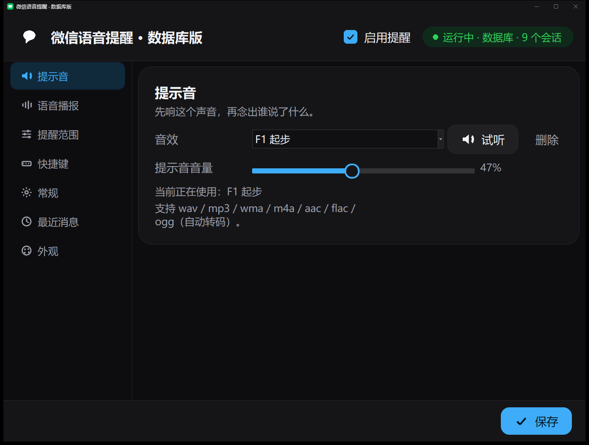
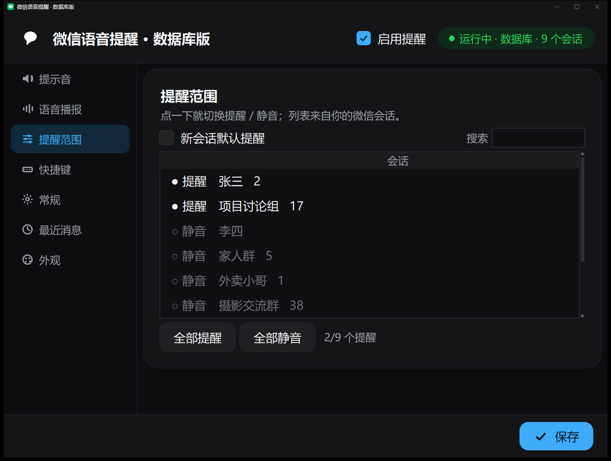
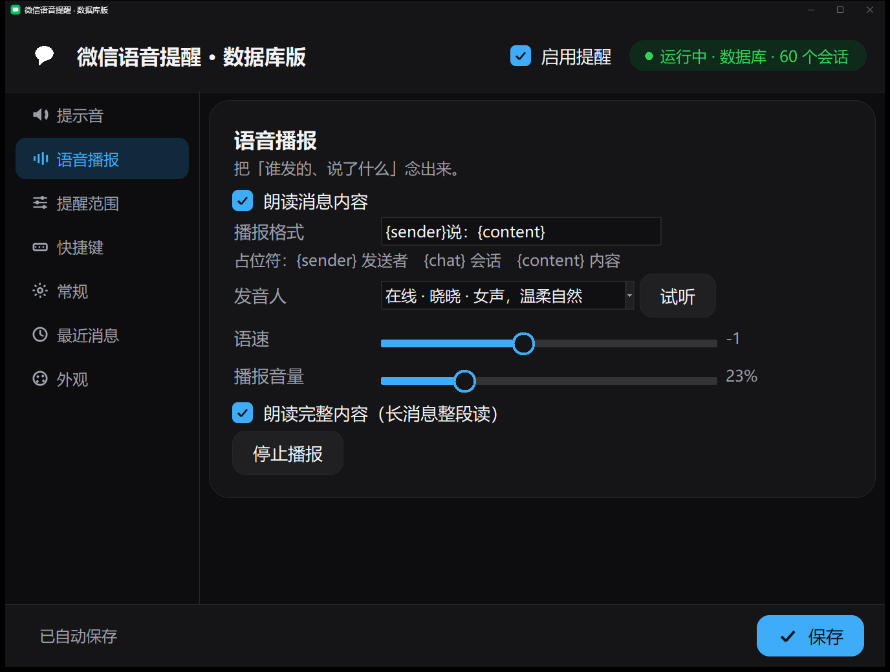
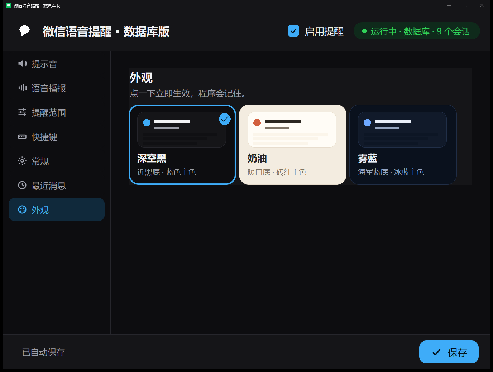
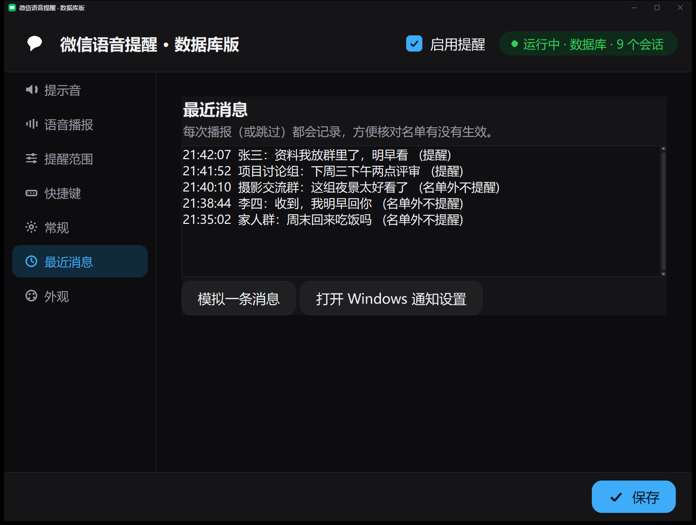

# 微信语音提醒（本地版）

把微信默认那声「叮」换成你喜欢的提示音，并把「谁、说了什么」直接念出来。
**不需要微信窗口**——开着、最小化、关到托盘都一样读得到，长消息也不会只念半截。



## 功能

- **自定义提示音**：内置 7 种音效（含 F1 起步），也可以选自己的音频文件，自动转码后永久保留
- **语音播报**：先响提示音，再念「某某说：内容」；在线神经网络语音（晓晓等）或本地语音可选
- **提醒名单**：直接列出你的微信会话，点一下切换「提醒 / 静音」，不用手输名字；提醒的会自动置顶
- **完整内容**：长消息整段播报，不再只读会话列表那几十个字的预览
- **不念自己的消息**：按发送者身份判断，自己发出去的一律跳过
- **非文本消息**：图片、语音、视频、文件、链接会念成「发来一张图片」这类
- **连发合并**：同一个人连着发，后面的只念正文，不重复「某某说」
- **一键打断**：播报中途按快捷键立即停止（默认 `Ctrl+Alt+S`，可改）
- **三套配色**：深空黑 / 奶油 / 雾蓝，点一下立即切换；跟随系统 DPI，125% / 150% 缩放不变形
- **托盘常驻、开机自启、最近消息记录**

## 界面

| 提醒范围 | 语音播报 |
| --- | --- |
|  |  |

| 外观 | 最近消息 |
| --- | --- |
|  |  |

## 怎么读到消息的

程序读取本机已登录账号的消息数据（只读），不截图、不做 OCR、不模拟点击、不控制微信界面。
消息按增量拉取，只处理新到达的那几条；全部在本机完成，不联网、不上传任何内容。

本地数据的读取依赖 [`wechatauto-replica`](https://pypi.org/project/wechatauto-replica/)。

## 运行

```bash
uv venv .venv --python 3.11
uv pip install -r requirements.txt
.venv\Scripts\pythonw.exe app.py
```

配置保存在 `%APPDATA%\WeChatDBAlert\`（提示音库、名单、语音设置、最近消息日志）。

## 打包

```powershell
.\build.ps1
```

产物 `dist\WeChatDBAlert.exe`（单文件，约 140 MB，依赖较多所以偏大），并自动复制到
`%LOCALAPPDATA%\WeChatDBAlert\`。

## 已知限制

- 依赖微信的内部结构：微信大版本更新后，可能需要升级 `wechatauto-replica` 才能继续读取
- 只处理本机已登录的账号；换号后需要重启程序
- 首次启动要初始化几秒，之后很快
- 空闲时约 1% CPU（只轮询有变化的会话），整程序约 4%
- 程序是「系统级 DPI 感知」：跨不同缩放比例的显示器拖动时，由系统缩放整窗（会略糊），不会重新排版

## 说明

本项目只读取本机、当前登录账号自己的消息数据，用于本机提醒，不做转发、不做上传。
请自行评估在你的使用场景下是否合适；因微信更新或使用方式带来的问题由使用者自行承担。
